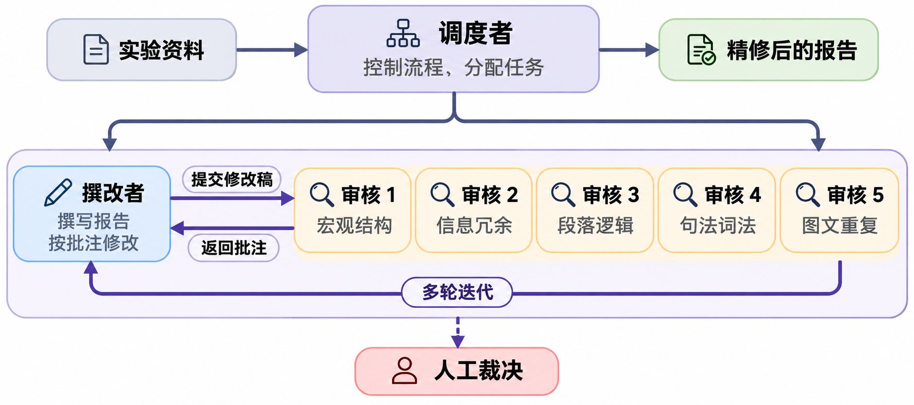

# Chinese-Report-Polishing

苦AI味写作久矣，遂写一个 Skill，只针对“中国理工科大学生实验报告撰写”这个场景，尝试做一些优化。至于实验怎么完成，建议向神灵祈祷；**实验指导书以及实验报告撰写的要求是本Skill很重要的资源**，如果想图省事，就应该把它们全部都爬下来，打包成Markdown传进项目里。本 Skill 核心负责语言与逻辑审查；Word 排版工程作为可选独立插件（默认不启用）。

> 你说得对，但我将要开始探针、快照、证据、门禁、夹具，还有哈希、冒烟、基线了。我要先建立唯一基线，再进行可追溯备份，先进行最小改动，我先进行一轮烟测，检查114个门禁是否通过，上线前进行一轮全量dry-run，上线后校验哈希值，最后进行一轮实测的验收矩阵！

我非常希望获得更多真实的修改的例子，以及人类的批注。目前正在做大量数据收集的工作，尝试训练一个会说人话的小模型，返璞归真。期待PR和Issue，任何实例都极其宝贵。

---

## 快速开始

**1. 安装技能**
在对话中输入：
> “请安装技能：https://github.com/Kang-Zhaoyuan/Chinese-Report-Polishing.git”

**2. 准备材料并启动**
准备三样材料（放入目录或告知路径）：**实验指导书**、**实验代码/修改补丁/日志**、**报告文稿（若已有）**。

在对话中输入：
> “请使用 chinese-report-polishing 技能处理我的实验报告。指导书是 ……，代码在 ……，文稿是 ……（若无初稿则直接从零撰写）。（可选，不需要可删：顺便帮我排版）”

---

## 一、 运行机制

系统采用三层角色隔离架构，通过 `.polish_workspace/` 下的本地文件交换数据，原生支持 `.docx` 文稿的提取与审改：
- **顶层调度者 (Orchestrator)** ：主线程，仅负责核验材料是否齐全、按工序运行专项静态扫描脚本、派发子线程及控制工序流转，不在自身上下文中载入指导书或报告正文。
- **常驻撰改者 (Writer-Refiner)** ：单一持久子线程，全程复用同一会话完成写稿与多轮改稿，掌握实验代码与历轮修改依据，在审核意见违背专业事实时行使反驳权。
- **四类专职审核分身 (Specialist Reviewers)** ：专人干专事，每道工序绑定独立的扫描模块并新建独立子线程，按 **宏观结构审核（第 1～3 类） → 信息冗余审核（第 4～8 类） → 段落逻辑审核（第 9～10 类） → 句法词法审核（第 11～15 类）** 依次推进，单轮结束后即销毁。同一位置往返分歧达 2 次时，标记为 `HOLD_FOR_HUMAN` 交由人工裁决。

---

## 二、 文件导航

- [SKILL.md](SKILL.md)：技能入口与顶层调度执行步骤。
- [references/architecture.md](references/architecture.md)：三层线程职责、四道专职审核工序及文件通信协议。
- [references/writer_guide.md](references/writer_guide.md)：常驻撰改者核心规范（4 项硬性技术写作约束）。
- [references/error_taxonomy.md](references/error_taxonomy.md)：15 类语言错误总谱导航索引与工序映射（下设 4 个工序独立子手册）。
  - [references/taxonomy_stage1_structure.md](references/taxonomy_stage1_structure.md)：工序一专属手册（第 1～3 类）。
  - [references/taxonomy_stage2_redundancy.md](references/taxonomy_stage2_redundancy.md)：工序二专属手册（第 4～8 类）。
  - [references/taxonomy_stage3_logic.md](references/taxonomy_stage3_logic.md)：工序三专属手册（第 9～10 类）。
  - [references/taxonomy_stage4_syntax.md](references/taxonomy_stage4_syntax.md)：工序四专属手册（第 11～15 类）。
- [references/classic_critiques.md](references/classic_critiques.md)：8 个多轮自然段拆解与演进案例。
- [references/reviewer_prompt.md](references/reviewer_prompt.md)：撰改者开局指令与四类专职审核分身的派发指令模板。
- [references/rules_word_typesetting.md](references/rules_word_typesetting.md)：【可选插件】Word 实验报告紧凑排版工程规范（空行三态、跨页流式代码框、双轨字体与 OMML 原生公式）。
- `scripts/`（模块化静态扫描器，配对四个审核分身）：
  - [scripts/check_prose.py](scripts/check_prose.py)：命令行总控调度入口（支持 `--stage` 与 `--extract`）。
  - [scripts/doc_parser.py](scripts/doc_parser.py)：`.docx` 非代码框表格递归解析、跨行自然段合并及纯文本镜像导出模块。
  - [scripts/scan_structure.py](scripts/scan_structure.py)：配对【宏观结构审核者】。
  - [scripts/scan_redundancy.py](scripts/scan_redundancy.py)：配对【信息冗余审核者】。
  - [scripts/scan_logic.py](scripts/scan_logic.py)：配对【段落逻辑审核者】。
  - [scripts/scan_syntax.py](scripts/scan_syntax.py)：配对【句法词法审核者】。
