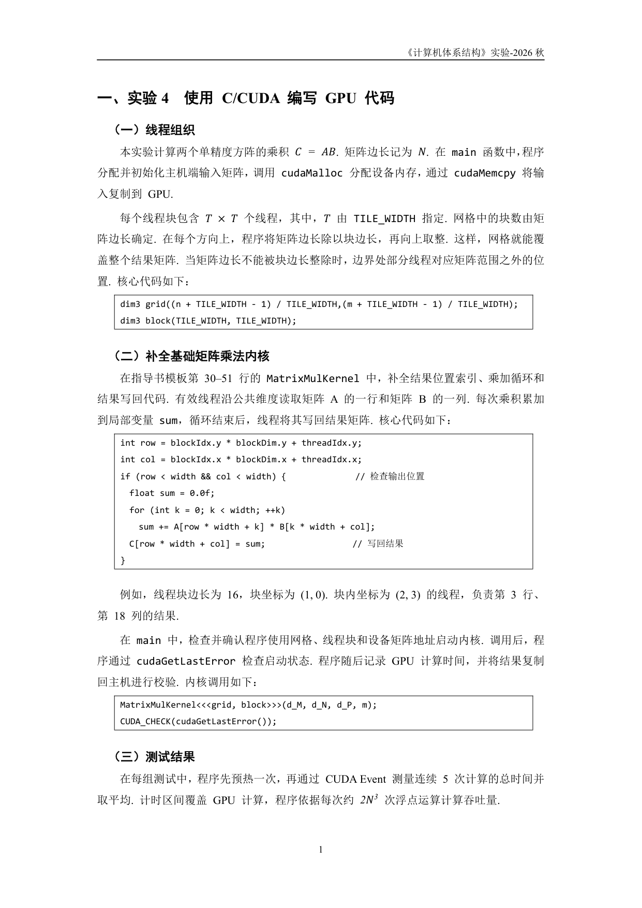
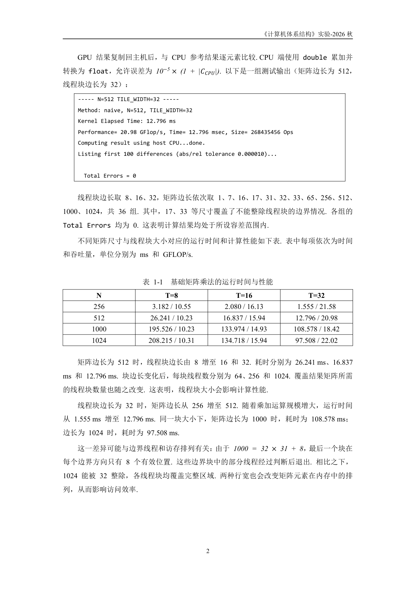
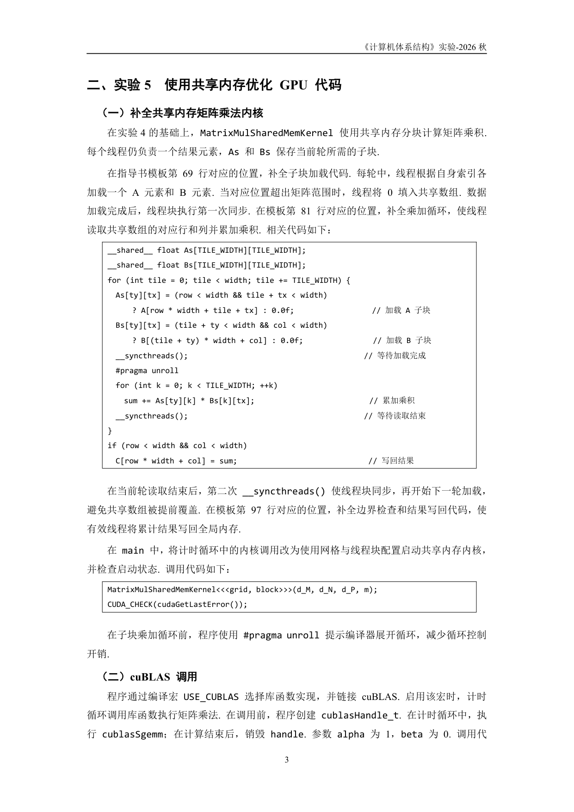
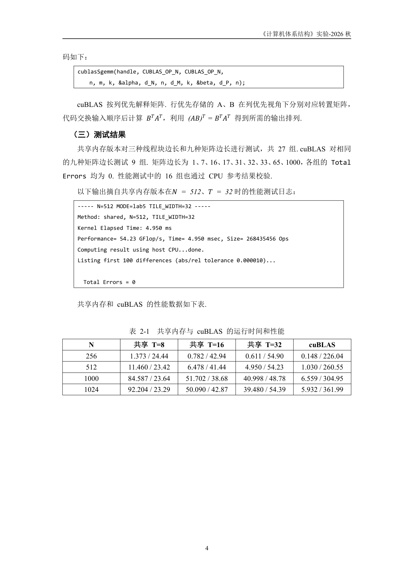

# 排版工程基准案例：CSAPP Lab 4-5 关键版面解析

> 本文档选取《计算机体系结构》CSAPP Lab 4-5 最终定稿报告（`报告-2024311150-康钊源.pdf`）中的关键页作为排版基准参考。
> 深入展示：**代码框“上不空下空”、跨页流式布局、多列数据表“上下皆空”、西文双轨分工与原生 OMML 公式**的实际落地形态。

---

## 一、 案例一：代码框“上不空行、下空一行”与双轨字体（第 2 页）

### 版面解析与工程要点：
1. **代码框紧贴引导语（上不空行）**：
   - “核心代码如下：”段落直接连接 1×1 代码框，中间**无任何空行段落**；
   - 引导语段落设置 `keep_with_next = True`，防止在页末出现“引导语在页底、代码框被踢到下一页”的断裂现象。
2. **代码框后留出呼吸区（下空一行）**：
   - 代码框下方插入一个标准的 $11\text{ pt}$ 空行，再接下一个二级小标题“（二）补全基础矩阵乘法内核”。
3. **西文字体严格双轨**：
   - 代码与函数名：`cudaMalloc`、`cudaMemcpy` 采用 `Consolas` 等宽字体；
   - 硬件与通用英文：$\text{GPU}$、$\text{CPU}$ 保持 `Times New Roman`，未混淆为等宽字体。
4. **原生数学公式**：
   - $C = AB$、$N$、$T \times T$ 均采用 Word 原生矢量公式（OMML），单字母斜体，乘号为标准直立体。

---

## 二、 案例二：数据表格“上空一行、下空一行”与终端日志框化（第 3 页）

### 版面解析与工程要点：
1. **纯文本终端输出代码框化**：
   - 评测程序的终端运行日志（`Kernel Elapsed Time: 12.796 ms`、`Total Errors = 0`）**不使用截图**，直接使用 1×1 代码框包裹，字体统一为 `Consolas` $11\text{ pt}$，清晰专业。
2. **多行多列数据表格的空行三态**：
   - 与 1×1 代码框不同，多行多列的数据统计表（表 1-1）**上方空一行、下方也空一行**，使其在正文流中独立成块；
   - 表头中的变量参数（如 $T=8$、$T=16$、$T=32$）嵌入原生 OMML 数学公式。

---

## 三、 案例三：长代码跨页流式布局与反斜杠注释对齐（第 4～5 页）

### 第 4 页（页末自然切入）：

### 第 5 页（页顶平滑承接）：

### 版面解析与工程要点：
1. **代码框跨页平滑流式断开（绝无死白留白）**：
   - 共享内存矩阵乘法核心内核代码长达数十行，第 4 页底部仅剩半页空间；
   - **表格未设置 `<w:cantSplit/>`，行间未强制设 `keep_with_next`**；
   - 代码在第 4 页底部填满后，剩余代码平滑流到第 5 页顶端继续显示；
   - 第 4 页底部被彻底吃透，版面极其饱满紧凑，彻底避免了整框掉到下页导致的半页刺眼空白。
2. **注释反斜杠视觉对齐（VS Code Beautifier 风格）**：
   - 代码框内的行尾中文注释（`// 加载A 子块`、`// 加载B 子块`），反斜杠在垂直列上保持对齐，视觉极为整洁。
3. **公式自适应**：
   - 第 5 页中的矩阵转置等式 $(AB)^T = B^T A^T$ 使用原生矩阵与上标公式呈现。
