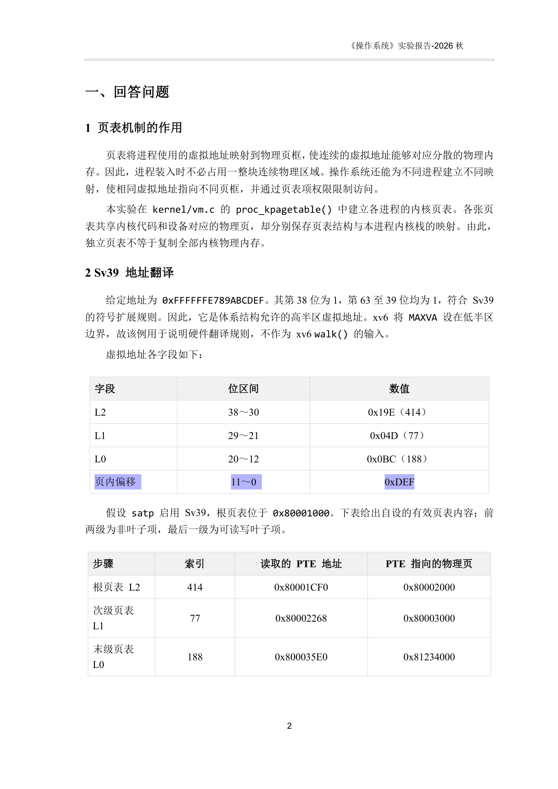
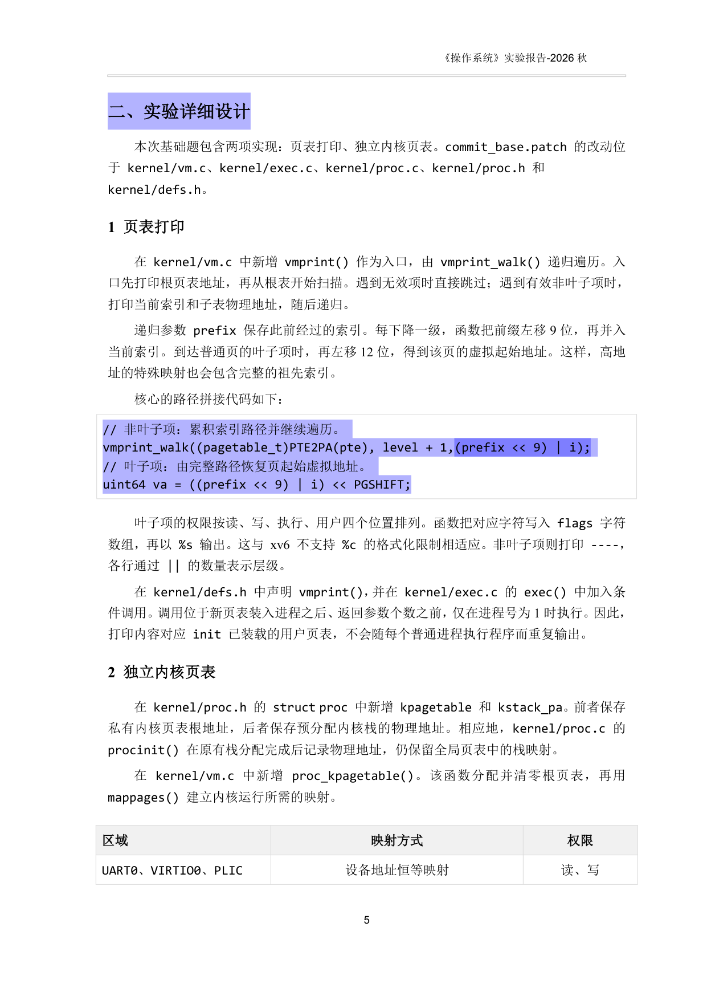
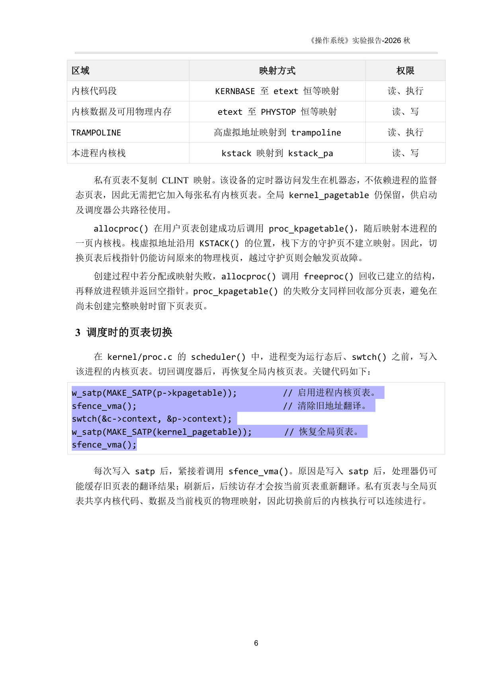
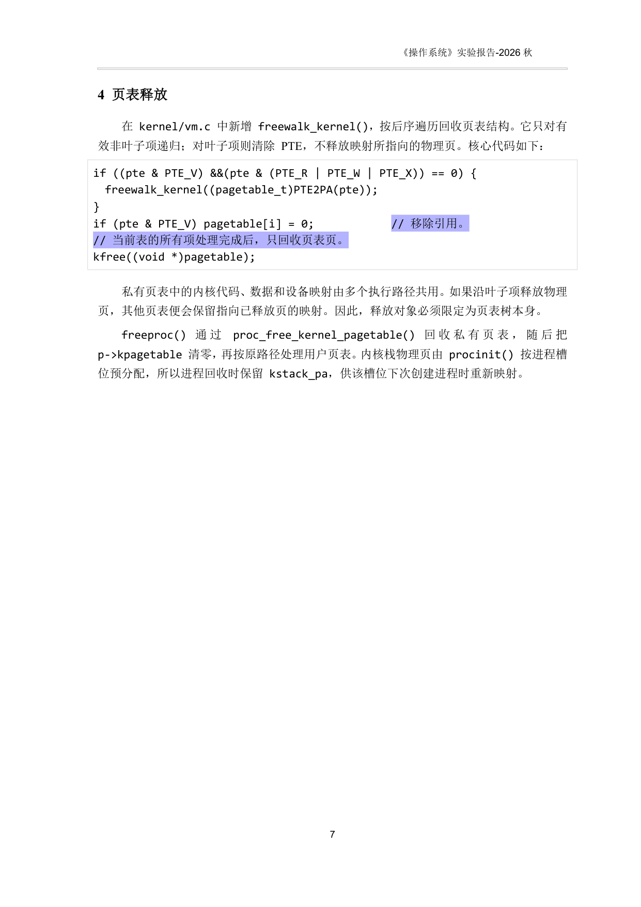

# 排版工程基准案例：操作系统 Lab 4 关键版面解析

> 本文档选取《操作系统》实验四（虚拟内存与页表机制）最终定稿与手动批注报告（`操作系统实验四报告_基础题_手动批注参照.docx`）作为排版基准参考。
> 核心聚焦：**8523 dxa 居中收窄基准、核心大章节另起新页（Page Break）、$\le 68$ 字符代码框拒绝非必要折行、VS Code Beautifier 风格行尾注释第 44 列垂直对齐、独立长注释顶格**的具体工程落地形态。

---

## 一、 案例一：表格与代码框宽度收窄至 8523 dxa 居中基准（第 2 页）



### 用户批注与工程对照：
> **用户批注（批注 0 & 批注 2）**：
> *“这里我把表格变窄了，表格的宽度应当比文本的宽度略微窄一些，我手动修改了一个，以这张表格为基准，以后都用这个宽度。”*
> *“整个表格也要和之前的批注一样，变窄一点”*

### 核心参数与 XML 工程对比：
| 属性项 | 修改前（`f1` 粗糙状态） | 修改后（`f2` 基准定死状态） | 工程意义 |
| :--- | :--- | :--- | :--- |
| **表格总宽 (`tblW`)** | `tblW[@w="0"][@type="auto"]`（填满版心 9128 dxa） | `tblW[@w="8523"][@type="dxa"]` | 收窄为 $150.3\text{ mm}$，建立内嵌呼吸容器感 |
| **列宽总和 ($\sum w_i$)** | `2268 + 2835 + 4025 = 9128 dxa` | `1866 + 2835 + 3822 = 8523 dxa` | 各列尺寸精确收缩，总宽严格等于 8523 dxa |
| **水平对齐 (`jc`)** | `center`（因贴满边距无视觉内缩） | `center`（居中对齐） | 左右各留出 $302\text{ dxa} \approx 5.3\text{ mm}$ 留白 |
| **代码框应用** | 1×1 代码框宽度为 9099 dxa 贴满 | 1×1 代码框统一同步收窄为 **8523 dxa** | 全文所有表格与代码框视觉尺度严格统一 |

---

## 二、 案例二：核心大章节另起新页与代码框拒绝非必要折行（第 5 页）



### 用户批注与工程对照：
> **用户批注（批注 1）**：
> *“开始了一个新的大的部分，“二、实验详细设计”，要确保其另外开启一页。”*
> 
> **用户批注（批注 3 & 批注 5）**：
> *“代码中似乎出现了不必要的换行，这样的换行是不可取的。”*
> *“多了一些空格”*

### 版面解析与工程要点：
1. **大章节独立开启新页（强制分页）**：
   - 一级大标题“二、实验详细设计”设置 `w:pageBreakBefore` 或前置插入 `<w:br w:type="page"/>`；
   - 彻底解决上一章节问答题结尾后，大标题突兀孤悬在页末最后几行的断层感，确保核心技术实现从全新页面顶端清晰展开。
2. **代码框单行容量极限与单行完整性（68 字符法则）**：
   - **错误状态**：旧引擎按 58 字符过早截断，将 68 字符以内的正常调用生硬切成两行并插入悬挂空格：
     ```c
     // 错误示范：过早切断产生不必要换行与悬挂空格
     vmprint_walk((pagetable_t)PTE2PA(pte), level + 1,
                  (prefix << 9) | i);
     ```
   - **定死基准**：在 8523 dxa 宽度下，Consolas 11pt 字符容量为 68 字符。该调用（63 字符）完全可以整行容纳，必须合并为单行完整展示：
     ```c
     // 正确基准：单行完整保留，严禁碎裂
     vmprint_walk((pagetable_t)PTE2PA(pte), level + 1,(prefix << 9) | i);
     ```

---

## 三、 案例三：VS Code Beautifier 风格行尾注释垂直列对齐（第 6 页）



### 用户批注与工程对照：
> **用户批注（批注 4）**：
> *“我修改了3个批注的位置： 1.这三个批注我都右移了 2.可以看到，批注的“//”在竖直方向是对齐的，好似VS Code的Butifier插件一样，注释对齐会更美观。”*

### 代码结构与垂直对齐工程解析：
- **错误排版**：粗暴压缩空格为 2 格（`  //`），注释紧贴长短不一的代码末尾，导致 `//` 参差不齐：
  ```c
  // 错误示范：// 参差不齐，视觉杂乱
  w_satp(MAKE_SATP(p->kpagetable));  // 启用进程内核页表。
  sfence_vma();                    // 清除旧地址翻译。
  swtch(&c->context, &p->context);
  w_satp(MAKE_SATP(kernel_pagetable)); // 恢复全局页表。
  sfence_vma();
  ```
- **基准排版**：将该代码块内所有行尾注释统一右移对齐到 **第 44 列**，形成一条笔直的垂直竖线：
  ```c
  // 正确基准：// 严格在第 44 列垂直对齐
  w_satp(MAKE_SATP(p->kpagetable));          // 启用进程内核页表。
  sfence_vma();                                // 清除旧地址翻译。
  swtch(&c->context, &p->context);
  w_satp(MAKE_SATP(kernel_pagetable));       // 恢复全局页表。
  sfence_vma();
  ```

---

## 四、 案例四：独立长注释顶格与行尾注释右对齐分工（第 7 页）



### 用户批注与工程对照：
> **用户批注（批注 6）**：
> *“如果是一句长注释，倒是可以顶格”*

### 版面解析与工程要点：
- 代码块内部严格实行“注释双轨分工”：
  1. **行尾跟随注释**：`if (pte & PTE_V) pagetable[i] = 0;             // 移除引用。` 保持与上文右对齐列对齐；
  2. **独立单行长注释**：`// 当前表的所有项处理完成后，只回收页表页。` 纯用于解释后续动作，**不参与右侧列对齐，直接顶格或跟随作用域缩进**，紧接后续 `kfree((void *)pagetable);` 执行。
- 复合分支条件拒绝碎片化折行：
  ```c
  // 正确基准：保持单行紧凑完整（58 字符以内），严禁拆分成两行
  if ((pte & PTE_V) &&(pte & (PTE_R | PTE_W | PTE_X)) == 0) {
    freewalk_kernel((pagetable_t)PTE2PA(pte));
  }
  ```
