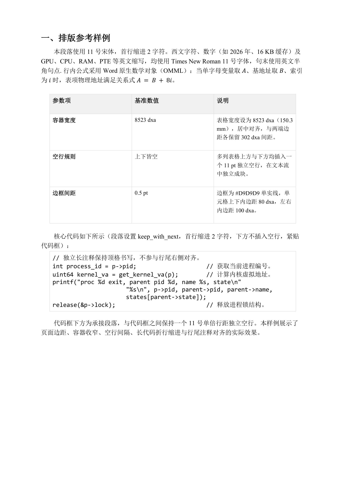

# 排版工程基准案例：排版参考样例

> 本文档通过一篇兼具全要素覆盖与“自指叙述（Self-Referential）”特性的紧凑短文，集中展示排版模块的所有工程规则。
> 文中的每一句话、每一个表格与代码块，均直接陈述其自身的排版参数与视觉形态。

---

## 一、 版面效果预览



---

## 二、 范文正文与逐段工程自指解析

### 1. 一级大标题（大章节另起新页）
- **范文文本**：`一、自指排版示范范文`
- **工程参数**：
  - 段落属性：`keep_with_next = True`；
  - 分页属性：设置 `<w:pageBreakBefore/>` 强制另起新页；
  - 字体：小二号（$15\text{ pt}$）加粗，中文字体宋体，西文 Times New Roman。

---

### 2. 正文段落（字体选用与内联原生公式）
- **范文文本**：
  > 我是 $11\text{ pt}$ 宋体正文段落，首行缩进 2 字符。我的西文散文词汇、数字（例如 2026 年、16 KB 缓存）以及 $\text{GPU}$、$\text{CPU}$、$\text{RAM}$、$\text{PTE}$ 等体系结构英文缩写，均严格使用 Times New Roman 11 号字体，句末使用英文半角句点. 接下来，我将在行内展示 Word 原生矢量公式（OMML）：当单字母变量取 $A$、基地址取 $B$、索引为 $i$ 时，表项物理地址满足推导式 $A = B + 8i$。
- **工程参数**：
  - 段落缩进：`ind[@firstLine="440"]`（首行缩进 2 字符）；
  - 行距与段落间距：单倍行距，段后间距 $4\text{ pt}$（$80\text{ dxa}$）；
  - 公式：OMML `m:oMath` 原生对象，变量 $A$、$B$、$i$ 斜体，数字 $8$ 直立体。

---

### 3. 数据统计表（8523 dxa 居中收窄与上下皆空）
- **空行控制**：表格上方插入 $11\text{ pt}$ 独立空行段落，表格下方同样插入 $11\text{ pt}$ 独立空行段落。
- **表格结构与自指内容**：

| 列名项 | 基准尺寸 | 排版自指说明 |
| :--- | :--- | :--- |
| **容器宽度** | $8523\text{ dxa}$ | 本表格总宽严格设为 $8523\text{ dxa}$（$150.3\text{ mm}$），水平居中对齐，与两端边距各保留 $302\text{ dxa}$ 呼吸留白。 |
| **空行三态** | 上下皆空 | 作为数据统计表，本表格上方与下方均严格插入了一个 $11\text{ pt}$ 独立空段落，在文本流中独立成块。 |
| **边框间距** | $0.5\text{ pt}$ 浅灰 | 边框为 `#D9D9D9` 单实线，单元格上下内边距 $80\text{ dxa}$，左右内边距 $100\text{ dxa}$，各列宽总和为 $8523\text{ dxa}$。 |

---

### 4. 代码框代码说明段落（首行缩进 2 字符、上不空行与防孤悬）
- **范文文本**：
  > 我是代码框的代码说明段落段落，首行同样缩进 2 字符，设置了 `keep_with_next = True`，下方绝不插入空行，紧贴核心代码框：
- **工程参数**：
  - 段落缩进：`ind[@firstLine="440"]`（与常规正文一致，首行缩进 2 字符）；
  - 段落属性：显式包含 `<w:keepNext/>`；
  - 空间位置：紧挨代码框表格上方，中间严禁存在空段落。

---

### 5. 1×1 代码框（Beautifier 注释对齐、跨行挂起缩进与流式跨页）
- **容器参数**：单单元格表格，`tblW[@w="8523"]`，水平居中对齐；**绝对不添加 `<w:cantSplit/>`**。
- **代码框内容**：

```c
// 我是独立单行长注释，直接顶格陈述逻辑步骤，严禁参与行尾右侧对齐。
int process_id = p->pid;                     // 获取当前进程编号。
uint64 kernel_va = get_kernel_va(p);        // 计算内核虚拟地址。
printf("proc %d exit, parent pid %d, name %s, state\n"
       "%s\n", p->pid, parent->pid, parent->name,
       states[parent->state]);
release(&p->lock);                          // 释放进程锁结构。
```

- **工程自指要点**：
  1. **首行长注释**：以 `//` 开头，顶格书写，不参与右对齐；
  2. **多行行尾注释**：`// 获取当前进程编号。`、`// 计算内核虚拟地址。` 和 `// 释放进程锁结构。` 的双斜杠 `//` 严格在垂直方向对齐成一条直线；
  3. **超长逻辑单行代码**：`printf` 语句超出单行容量，在格式化字符串处使用软换行断开，后续续行自动应用挂起缩进，深缩进对齐在 `printf(` 的参数层级内部。

---

### 6. 代码框下承接段落（下空一行）
- **范文文本**：
  > 我是代码框下方的承接段落，与上方代码框之间保持了一个 11 号单倍行距独立空行。本自指范文完整展示了版面边距、容器收窄、空行三态、逻辑代码折行与垂直注释对齐的所有工程要求。
- **工程参数**：上方与代码框之间存在一个标准 $11\text{ pt}$ Spacer 空行。
